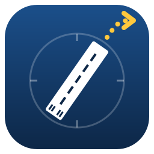
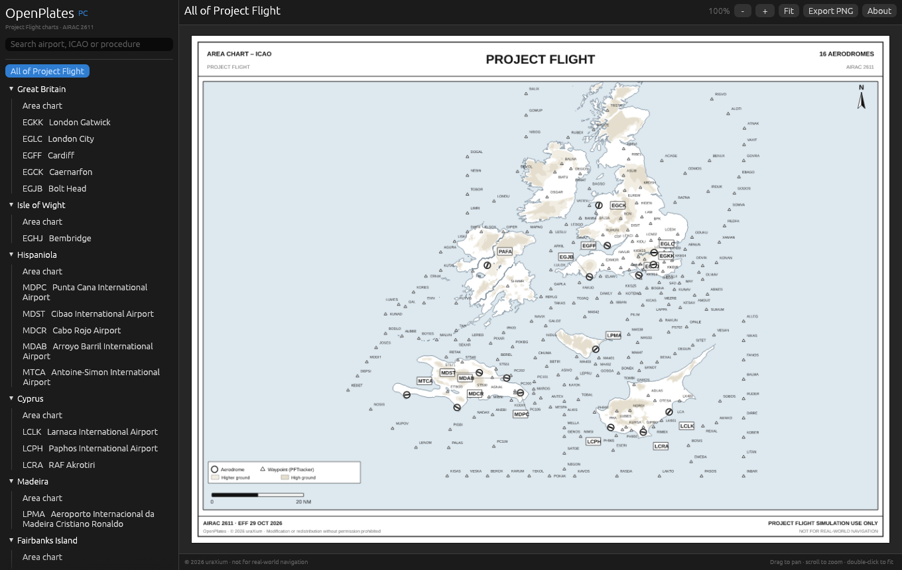
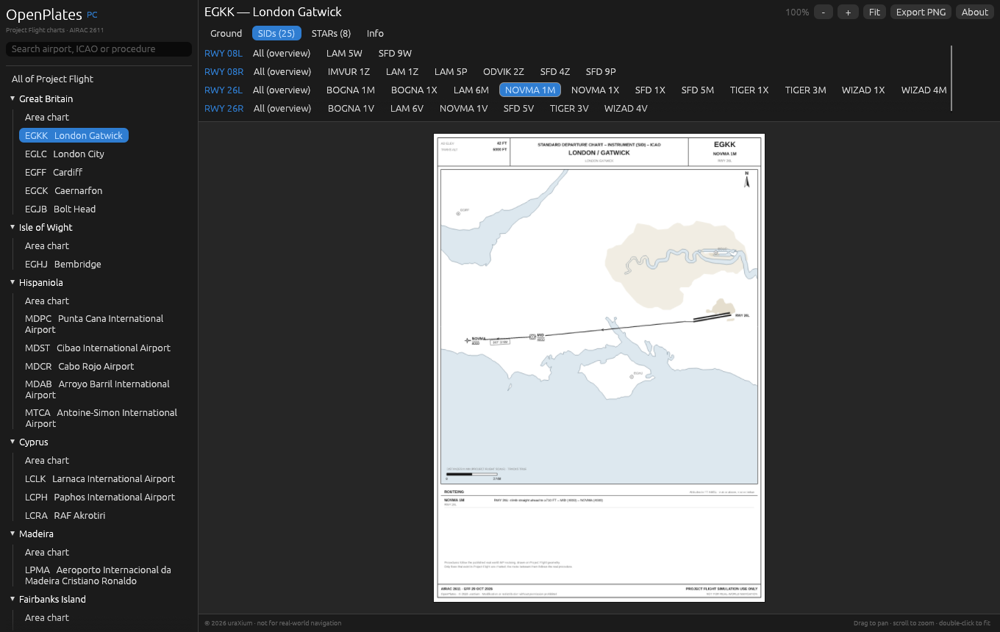
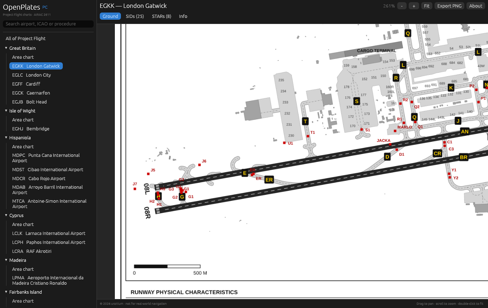
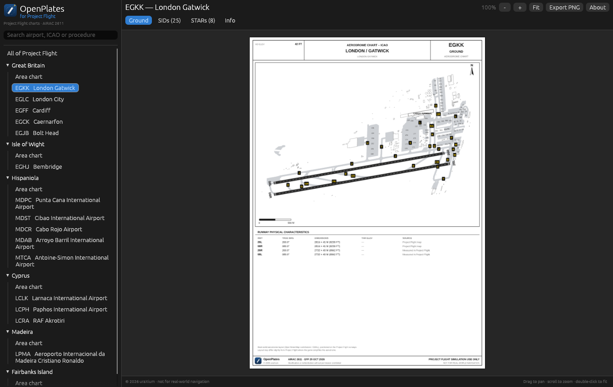
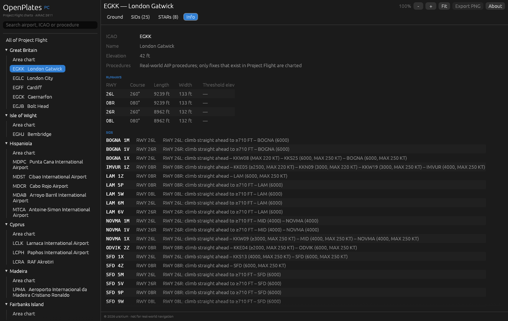

<p align="center"></p>

<h1 align="center">openCharts</h1>

<p align="center"><em>A <a href="https://coral-reef-studios.vercel.app/">Coral Reef Studios</a> product · formerly OpenPlates · <a href="https://discord.gg/8SpHYeVhN9">Discord</a></em></p>

**Real-world-style aviation charts for [Project Flight](https://www.roblox.com/games/6349094071/Project-Flight-Alpha) (Roblox), in a fast desktop app.**

Area charts, aerodrome charts, SIDs and STARs for every Project Flight airport, drawn in ICAO AIP style: real-world procedures and taxiway names, fitted to the actual Project Flight map.



> ⚠️ Unofficial. Not affiliated with Project Flight or Roblox. For simulation only: **never use these charts for real-world navigation.**

---

## Download

1. Go to **[Releases](https://github.com/dev-uraXium/opencharts/releases/latest)**.
2. Download **`openCharts-Setup.exe`** (recommended) and run it. No admin rights needed.
   It adds openCharts to the Start menu and desktop, and you can uninstall it from *Settings → Apps*.
   Prefer no install? Download `openCharts.exe` instead and just double-click it.

Windows may show a blue *"Windows protected your PC"* box the first time, because the app isn't code-signed. Click **More info → Run anyway**.

**Updates:** openCharts (1.4.0 and later) checks GitHub when it starts. When a new version is out, a banner appears: click **Update now** and it downloads, installs and restarts by itself. You can also use **About → Check for updates**. Versions before 1.4.0 can't update themselves: download the latest release once and you're set.

Requirements: Windows 10 or 11 (64-bit) with OpenGL 2.0+ (any GPU from the last ~12 years).

## What's inside

| | |
|---|---|
| **6 islands** | Great Britain, Isle of Wight, Hispaniola, Cyprus, Madeira, Fairbanks Island, plus a chart of the whole map |
| **16 airports** | Ground chart, SIDs, STARs and an info page for each |
| **247 SID & STAR charts** | Real-world AIP procedures, drawn on Project Flight fixes, grouped by runway with an "All" overview |
| **270 charts** in total | All built into the app, no internet needed · AIRAC 2611 |

## How to use

### Finding a chart
- **Sidebar:** pick a region's **Area chart**, or click an airport.
- **Search:** type an ICAO (`EGKK`), a name (`Gatwick`) or a procedure (`WIZAD`). Procedure results open straight to that chart.

### Airport tabs
| Tab | Shows |
|---|---|
| **Ground** | Runways, taxiways, aprons and buildings |
| **SIDs** | Departures. Pick a runway row, then a procedure, or **All (overview)** to see every SID from that runway |
| **STARs** | Arrivals, same layout as SIDs |
| **Info** | Elevation, frequencies, runway table (course, length, width) and every procedure's route in text |



### Moving around a chart
| Action | How |
|---|---|
| Zoom | Mouse wheel / trackpad pinch, or the **+** / **-** buttons |
| Pan | Click and drag |
| Fit to window | Double-click, or **Fit** |

Charts redraw sharper as you zoom in (up to 800%).



### Drawing on charts
Click **Draw** (or press **D**) to mark up the chart you're looking at.

| Action | How |
|---|---|
| Pen / Highlighter / Eraser | Toolbar, or **P** / **H** / **E** |
| Colour and size | 6 colours, S / M / L |
| Draw | Left-drag (click for a dot) |
| Pan while drawing | Right-drag (scroll still zooms) |
| Undo / Redo | Ctrl+Z / Ctrl+Y |
| Leave draw mode | **Done** or **Esc** |

Drawings stay pinned to the chart when you zoom and pan, are kept per chart, and are saved automatically (`%APPDATA%\openCharts\drawings.json` on Windows). **Clear chart** removes them (and can be undone). Exported PNGs never include drawings.

### Exporting
**Export PNG** saves the chart you're looking at as a high-resolution image (3×), ready to print or put on a second screen.
You may share exported images as-is; you may not edit them or pass them off as your own (see [License](#license)).

## Screenshots

| Ground chart | Airport info |
|---|---|
|  |  |

---

## Building from source

The app is written in Rust with [egui](https://github.com/emilk/egui) (UI) and [resvg](https://github.com/linebender/resvg) (chart rendering).

```bash
# Windows, macOS or Linux, native build
cargo build --release

# Windows .exe from Linux (needs mingw-w64 and the x86_64-pc-windows-gnu target)
rustup target add x86_64-pc-windows-gnu
cargo build --release --target x86_64-pc-windows-gnu

# Windows installer (needs NSIS / makensis)
cp target/x86_64-pc-windows-gnu/release/opencharts.exe target/x86_64-pc-windows-gnu/release/openCharts.exe
makensis -DVERSION=1.4.0 installer/opencharts.nsi   # -> target/openCharts-Setup.exe
```

### About the chart bundle

The chart data is **not** in this repository. The official release embeds an encrypted bundle (`private/charts.bin` + `private/key.rs`) that is kept private.

If you build from a fresh clone, `build.rs` notices that `private/` is missing, builds the app anyway, and the app tells you it has no charts. To build with charts you need your own bundle:

1. Put one SVG per chart, plus an `_index.json` describing them, in `export/`.
2. Run `python3 pack.py` (needs `cryptography`). It writes `private/charts.bin` and a fresh random `private/key.rs`.
3. `cargo build --release`.

Each chart is zlib-compressed and ChaCha20-encrypted with its own nonce, and is decrypted only in memory when opened. This keeps casual users from pulling the data out of the .exe; it is not DRM and won't stop a determined reverse-engineer.

### Project layout

```
src/main.rs     UI: sidebar, tabs, procedure chips, chart viewer, info page, about box
src/render.rs   background thread: decrypt → parse SVG → rasterise; PNG export
src/bundle.rs   reads the encrypted bundle compiled into the binary
src/update.rs   checks GitHub for new releases and installs them
installer/      NSIS script for openCharts-Setup.exe
build.rs        copies private/ into the build, or a placeholder if it's missing
pack.py         builds private/charts.bin + private/key.rs from export/
assets/         Liberation Sans fonts (SIL OFL 1.1)
docs/           landing page (GitHub Pages) and screenshots
```

## Contributing

Bug reports and pull requests for the app are welcome. Open an issue first for anything big.
Wrong chart? Open an issue with the airport, chart name and what's off (a screenshot helps), or tell us on [Discord](https://discord.gg/8SpHYeVhN9).

## License

- **Source code** (everything in this repository except `assets/` fonts): [GNU AGPL-3.0](LICENSE). Any copy, fork or modified version, including one offered as an online service, must stay open source under the AGPL with full source available, and keep the copyright notices. See [NOTICE](NOTICE).
- **Name:** "openCharts" may not be used for modified versions without permission.
- **Charts** (the chart bundle shipped in the official release, and images exported from it): © 2026 uraXium, all rights reserved. You may use them and share unmodified exports; modifying or redistributing them requires prior permission from uraXium.
- **Fonts:** Liberation Sans, [SIL Open Font License 1.1](assets/OFL.txt).
- **Data credits:** waypoints from PFTracker; some ground layouts © [OpenStreetMap](https://www.openstreetmap.org/copyright) contributors (ODbL 1.0); some taxiway designators from the X-Plane Scenery Gateway. Aerodrome pavement is traced from the Project Flight map.

Project Flight and Roblox are trademarks of their respective owners. openCharts is a fan project and is not endorsed by them.
